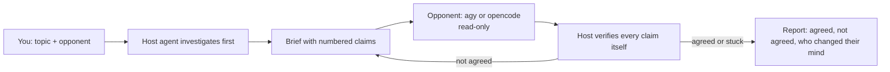

# debate-skills

**Have your agent debate another agent, then bring you only what they agreed on.**

Ask the agent you are already chatting with (Codex, Claude Code, Cursor, anything that runs shell commands) to check a feature, a bug, or a commit history and debate it with a second agent CLI: Google Antigravity (`agy`) or OpenCode. They go back and forth until they agree. Neither side takes the other's word for anything: your agent checks every claim against the code before it agrees or refuses, and the opponent is told to do the same to your agent.

```
npx skills add AhmedTharwat-AT/debate-skills
```

Then:

```
Use $debate-request to check the retry logic in the last 5 commits and debate it with agy.
```

```
Use $debate-request: debate with opencode whether src/cart/total.ts double-counts the discount. Up to 3 rounds.
```

```
Use $debate-request to debate this design with both agy and opencode and tell me where they disagree.
```



## What you get

- **Verification on both sides.** The host confirms or refutes each opponent claim by reading the code and git history itself. The opponent's brief orders it to verify the host's claims the same way and to cite file, line, or commit for everything.
- **Real agreement only.** At the end the host sends the proposed consensus points and the opponent must answer AGREE or DISAGREE on each with a note of what it checked. "Sounds good" does not count.
- **Honest stalemates.** After 5 rounds (or your limit), or two rounds with nothing new, you get both positions and what would settle the difference.
- **Read-only.** The opponent runs in agy's sandbox or OpenCode's `plan` agent, and a git fingerprint before and after each round reports any file it changed.

## Choose the opponent

| You say                                  | Opponent                            | Default model                  |
| ---------------------------------------- | ----------------------------------- | ------------------------------ |
| "debate with agy" / Gemini / Antigravity | `agy`                               | Gemini Flash 3.8, high effort  |
| "debate with opencode"                   | `opencode`                          | strongest free model installed |
| "with both"                              | both, each round                    | the two defaults               |
| nothing                                  | `agy` if installed, else `opencode` | the default for that opponent  |

Name a model or effort in your request and that wins. Only free OpenCode models are picked automatically; paid ones are billed per token, so you have to name them.

## Install

Browse first:

```
npx skills add AhmedTharwat-AT/debate-skills --list
```

Install the package, or just the skill:

```
npx skills add AhmedTharwat-AT/debate-skills
npx skills add AhmedTharwat-AT/debate-skills --skill debate-request
```

For a specific agent, or globally:

```
npx skills add AhmedTharwat-AT/debate-skills --skill debate-request --agent codex
npx skills add AhmedTharwat-AT/debate-skills --global
```

To try it from a local checkout before publishing, run `npx skills add ./debate-skills --list` (or point at the folder you cloned). Works with any host agent the [Skills CLI](https://github.com/vercel-labs/skills) supports.

## Requirements

- Node 18+ and `git`.
- At least one opponent, installed and signed in:
  - `agy`: `curl -fsSL https://antigravity.google/cli/install.sh | bash`, then run `agy` once to sign in.
  - `opencode`: `npm i -g opencode-ai`. Its free models usually need no API key; if a run fails with an auth error, run `opencode auth login`.
- A host agent that can run shell commands and read files.
- Shell examples assume bash/zsh (macOS/Linux, or Git Bash/WSL on Windows).

## How the free OpenCode pick works

`debate.mjs discover` lists `opencode models`, keeps the free ones (`opencode/*-free` and `opencode/big-pickle`), and takes the first available from this order: DeepSeek V4 Flash, Nemotron 3 Ultra, MiMo V2.5, North Mini Code, Laguna S 2.1, LongCat 2.0, Big Pickle. That order is a judgment call, not a benchmark, and OpenCode's free list changes often. To change it, set `DEBATE_FREE_MODELS=big-pickle,mimo-v2.5-free`, or pass `--model` for one run. See [opponents.md](skills/debate-request/references/opponents.md).

## Trust and validation

This package is intentionally inspectable:

- All skill content is Markdown, plus one script: `skills/debate-request/scripts/debate.mjs`.
- The script uses Node built-ins only: no dependencies, no network calls of its own, no credentials, no telemetry. It launches the opponent CLI and `git`, and on native Windows the platform process-kill utility. The opponent CLIs contact their own services.
- It never commits and never edits your repository. It writes briefs, replies, and a transcript into a temp directory (or the `--debate-dir` you give it).
- Briefs given to `agy` travel on its command line, so they are visible in the process list on a shared machine. Keep secrets out of them.
- Read the script before you run it.

## Verification status

Be skeptical of anything not on this list.

- **Contract-tested against fake CLIs (29 cases, `node test/smoke.mjs`):** the argument lists built for both opponents, default and explicit model selection, the free-model order and `DEBATE_FREE_MODELS`, `--resume-last`/`--session`/`--conversation` mapping, brief delivery (agy argument, opencode stdin), reply parsing, the read-only tripwire (modified, already-dirty, and new files), the timeout watchdog, exit codes, missing binaries, usage errors, transcript and round numbering. Two mutation checks confirmed the tests fail when the tripwire is disabled or opencode is switched to a writable agent.
- **Not run against a real `agy` or a real `opencode`.** The flags come from public documentation and the open-source [delegate-skills](https://github.com/amElnagdy/delegate-skills) project, and agy and opencode both change their flags between versions. The first real run is the real test; `discover` and each CLI's `--help` are the places to check.
- **Not verified:** opencode's JSON event shape beyond the fields the relay reads defensively; whether opencode's `plan` agent can run shell commands headlessly; agy's model labels (the Gemini Flash 3.8 default is matched against `agy models`, so it works only if such a label exists, and falls back with a warning if not); agy conversation ids (not captured).
- **Not run on native Windows or macOS.** The opencode launch uses a shell on Windows to resolve its `.cmd` shim; that path has no test here, and the smoke suite skips itself on Windows.

## Repository shape

```
skills/
└── debate-request/
    ├── SKILL.md
    ├── scripts/debate.mjs
    └── references/
        ├── protocol.md
        └── opponents.md
test/smoke.mjs
skills.sh.json
AGENTS.md
CONTRIBUTING.md
```

Adding an opponent is a branch in `debate.mjs` plus tests and a section in `opponents.md`; see [CONTRIBUTING.md](CONTRIBUTING.md). House rules for editing live in [AGENTS.md](AGENTS.md).

## Acknowledgments

The package structure, the `AGENTS.md` conventions, and the idea of driving other agent CLIs through a small relay script are inspired by [delegate-skills](https://github.com/amElnagdy/delegate-skills) by amElnagdy. Its documentation was also the main reference for how `agy` and `opencode` are invoked headlessly.

The debate protocol (claim ledger, verify-before-agreeing, explicit consensus) and the relay code in `debate.mjs` are original to this project, which is not affiliated with delegate-skills. If you want to hand a coding task to another agent instead of debating one, use theirs.

## License

MIT, see [LICENSE](LICENSE).
